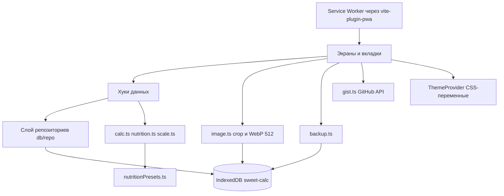

# План реализации PWA «Sweet Calc»

## 1. Исходное состояние

- Рабочая папка `e:/CODE/WebAPP/sweet-calc` **пуста**: нет `package.json`, `AGENTS.md`, git-истории.
- Проект создаётся с нуля как офлайн-приложение, размещаемое на GitHub Pages: `https://<username>.github.io/sweet-calc/`.

## 2. Принятые решения

| Вопрос | Решение | Обоснование |
|---|---|---|
| Кроппер фото | `react-easy-crop` | Пользователь выбрал готовое решение; библиотека сама обрабатывает drag, wheel, pinch |
| Размер фото рецепта | **512×512 px**, WebP q0.85, фоллбэк JPEG | Уточнение пользователя (вместо 400×400 из исходного ТЗ) |
| Тесты | `vitest` только для `src/lib/calc.ts`, `src/lib/nutrition.ts`, `src/lib/scale.ts` | В `node_modules`, в прод-бандл не попадает; ловит ошибки формул |
| Роутинг | Без `react-router`: активная вкладка в состоянии + синхронизация с `history.state` | Меньше зависимостей, GitHub Pages не требует 404-fallback |
| Tailwind | v3.4 + `darkMode: 'class'`, PostCSS | Стабильный API для классовой тёмной темы и CSS-переменных |
| Акцент | CSS-переменные `--accent`, `--accent-soft`, `--accent-foreground` на `<html>` | Мгновенная перекраска без перерендера компонентов |
| Округление цены | Вверх до шага (`Math.ceil`) | Не терять прибыль; фиксируется в `README` |
| Nакладные расходы | `mode: 'fixed'` (₽) или `mode: 'percent'` (% от себестоимости продукции) | ТЗ: «фикс. сумма ₽ или %» |
| Агар-агар в справочнике | 900 (как указано в ТЗ) с комментарием в коде | Значение задано заказчиком; помечено как требующее подтверждения |
| Заглушки | `public/placeholders/<id>.svg`, карта в `src/data/placeholders.ts` | Пользователь кладёт свои файлы без правки кода |
| Иконки PWA | `public/icons/source.svg` → PNG 192/512/maskable/180 скриптом `npm run icons` | PNG нужны для установки на Android/iOS |
| Gist-токен | Хранится только в IndexedDB, исключается из JSON-бэкапа | Секрет не попадает в файлы и Git |

## 3. Архитектура



Поток данных: UI → хуки → репозиторий (`idb`) → IndexedDB; расчёты выполняются на чтении чистыми функциями, без хранения производных значений.

## 4. Структура файлов

```
sweet-calc/
├─ .github/workflows/deploy.yml
├─ plans/sweet-calc-plan.md
├─ public/
│  ├─ icons/source.svg + icon-192.png + icon-512.png + icon-512-maskable.png + apple-touch-icon-180.png
│  └─ placeholders/{marshmallow-swirl,marshmallow-flowers,marmalade-cubes,pastila,meringue,bird-milk,truffles,gift-set}.svg
├─ scripts/generate-pwa-icons.mjs
├─ src/
│  ├─ main.tsx, App.tsx, index.css
│  ├─ types/index.ts
│  ├─ data/{nutritionPresets,placeholders,changelog,seedStock,demoRecipe}.ts
│  ├─ db/{index,repo}.ts
│  ├─ lib/{calc,nutrition,scale,image,format,backup,gist,clipboard}.ts
│  ├─ lib/__tests__/{calc,nutrition,scale}.test.ts
│  ├─ theme/{ThemeProvider,useTheme,accents}.tsx
│  ├─ hooks/{useSettings,useStock,useRecipes,useUpdatePrompt}.ts
│  ├─ components/{ui/*,RecipeImage,StockPicker,NutritionBadge}
│  └─ features/
│     ├─ calculator/CalculatorTab.tsx
│     ├─ products/{ProductsTab,RecipeView,RecipeForm,CropModal,PlaceholderPicker}.tsx
│     ├─ stock/{StockTab,StockForm}.tsx
│     └─ settings/{SettingsTab,AppearanceSection,PricingSection,BackupSection,GistSection,DataSection,ChangelogModal}.tsx
├─ vite.config.ts, tailwind.config.js, postcss.config.js, tsconfig*.json, eslint.config.js
├─ AGENTS.md, PROJECT_STATE.md, CHANGELOG.md, README.md
```

## 5. Модель данных

```ts
type StockType = 'food' | 'unit' | 'overhead';

interface Nutrition { proteins?: number; fats?: number; carbs?: number; kcal?: number }

interface StockItem {
  id: string;
  type: StockType;
  name: string;
  packAmount: number;      // food: граммы упаковки, unit: штуки в пачке, overhead: 1
  packPrice: number;       // ₽ за упаковку, для overhead — сумма
  overheadMode?: 'fixed' | 'percent';
  nutrition?: Nutrition;   // на 100 г, только food, все поля опциональны
  updatedAt: number;       // дата последнего изменения цены
  createdAt: number;
}

interface RecipeItem { stockItemId: string; amount: number } // г или шт

interface Recipe {
  id: string;
  name: string;
  image: { kind: 'custom'; dataUrl: string } | { kind: 'preset'; presetId: string };
  items: RecipeItem[];
  finalWeight: number;   // обязателен
  finalPieces?: number;
  notes?: string;
  createdAt: number;
  updatedAt: number;
}

interface Settings {
  theme: 'system' | 'light' | 'dark';
  accentId: string;
  markupPercent: number;        // по умолчанию 150
  roundingStep: 0 | 10 | 50 | 100;
  gistToken?: string;
  gistId?: string;
  lastSyncAt?: number;
}
```

Хранилища IndexedDB v1: `stock` (keyPath `id`, индексы `type`, `name`), `recipes` (`id`, индекс `name`), `settings` (`key`), `meta` (`key`: `seeded`, `schemaVersion`).

## 6. Формулы (единый источник — `src/lib`)

- `unitPrice(item)` = `packPrice / packAmount` (0 при `packAmount <= 0`); для `overhead` — `packPrice`.
- `batchCost(recipe)` = Σ `amount * unitPrice` по позициям `food`/`unit`.
- `costPerGram` = `batchCost / finalWeight`; `costPerPiece` = `finalPieces > 0 ? batchCost / finalPieces : null`.
- `nutritionPer100g` = `(Σ по ингредиентам nutrition_k * amount / 100) / finalWeight * 100`, пустые поля = 0, позиции `unit` без КБЖУ не влияют.
- Заказ: `share` = по штукам `pieces / finalPieces`, по весу `weight / finalWeight`; `productCost = batchCost * share`; `extras` = Σ `qty * unitPrice` + фиксированные накладные + проценты от `productCost`; `price = ceil((productCost + extras) * (1 + markup/100) / step) * step`; `profit = price - productCost - extras`.
- Режим замеса: `factor` = `targetWeight / finalWeight` либо `targetPieces / finalPieces`; граммовки умножаются на `factor` и округляются до 0.1 г.

## 7. Ключевые сценарии

- **Первый запуск**: сид стандартной упаковки (коробки 6/9/12/16, лента, капсула, наклейка, пакет, пергамент) + `meta.seeded`.
- **Фото**: загрузка → `CropModal` (react-easy-crop, 1:1) → Canvas 512×512, `imageSmoothingQuality='high'` → `toDataURL('image/webp', 0.85)` с проверкой префикса и фоллбэком JPEG.
- **Обновление PWA**: `registerType: 'prompt'`, `useRegisterSW`, тост внизу «Доступна новая версия приложения — Обновить».
- **Бэкап**: экспорт `sweet-calc-backup-YYYY-MM-DD.json` (без `gistToken`), импорт с режимами `replace` / `merge` (по `id`).
- **Gist**: `GET/PATCH https://api.github.com/gists/{id}`, файл `sweet-calc-backup.json`, индикатор `lastSyncAt`.
- **Копирование для клиента**: название, вес/штуки, состав по убыванию массы без упаковки, КБЖУ.

## 8. Проверки готовности

1. `npm run lint`, `npx tsc --noEmit`, `npm run test`, `npm run build` — без ошибок.
2. В `dist/` присутствуют `sw.js`, `manifest.webmanifest`, иконки, `base` пути начинаются с `/sweet-calc/`.
3. `npm run preview` — smoke-тест: сид склада, создание рецепта с фото, расчёт заказа, экспорт/импорт JSON.
4. Тёмная и светлая темы, акцент меняется мгновенно; `meta[name=theme-color]` обновляется.
5. Все `<input>/<textarea>/<select>` ≥ 16px, числовые поля с `inputmode="decimal"`.
6. `git status` / `git diff` просмотрены; коммит и пуш — только по отдельному разрешению.

## 9. Открытые вопросы к заказчику

- КБЖУ агар-агара: в ТЗ указано 900 (вероятно сила геля, а не ккал/100 г) — в справочнике ставим 900 с пометкой.
- Ориентировочные цены стандартной упаковки при сиде — ставятся 0 ₽ для ручного заполнения.
